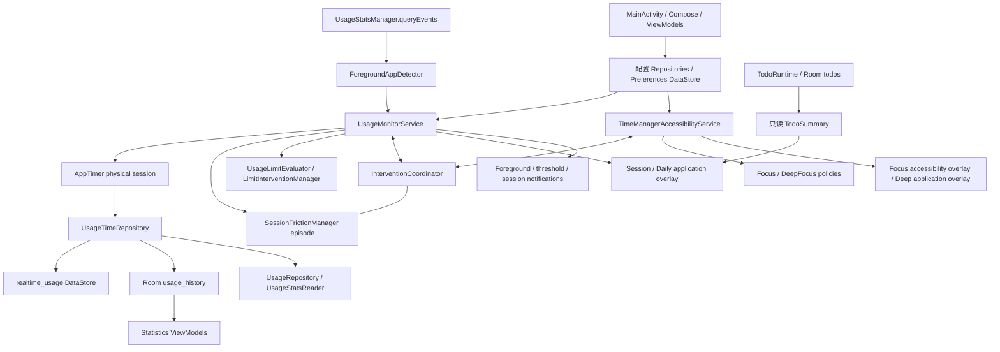
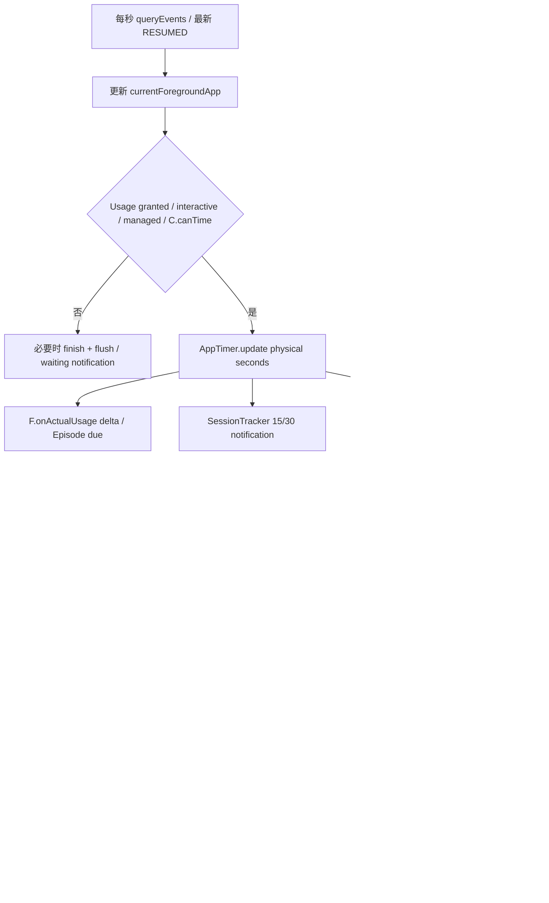
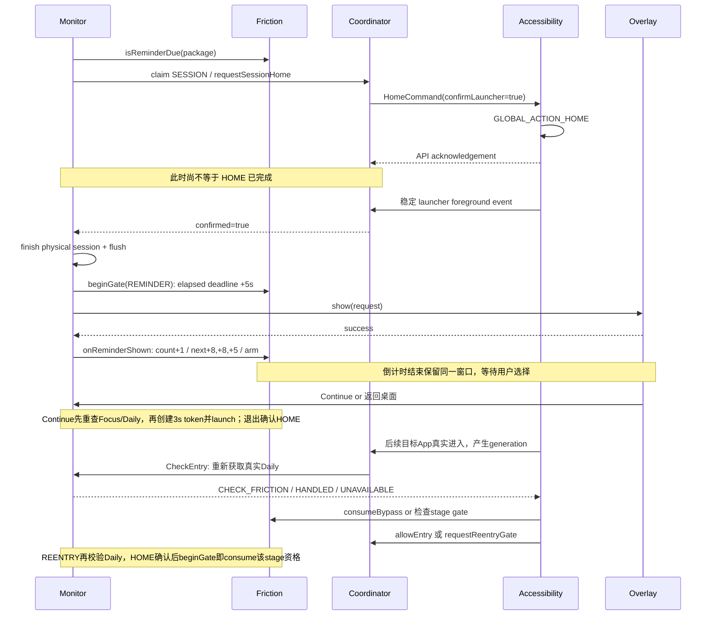
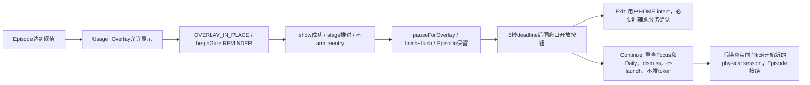
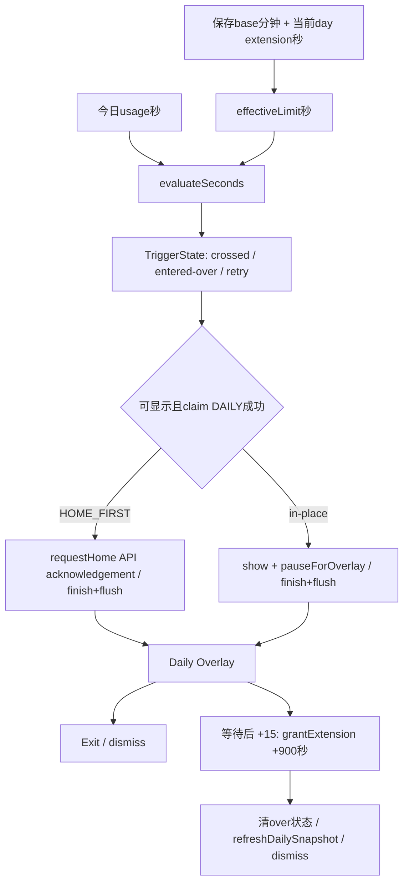
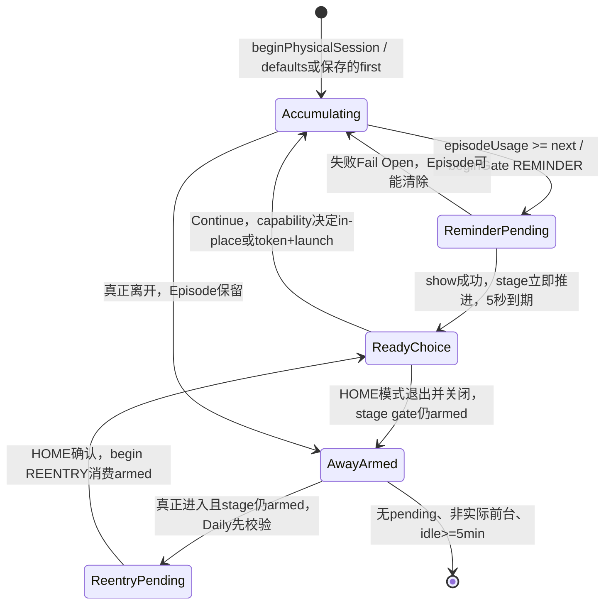

# v0.10.0 Phase 1 — Rules Engine Architecture Map

审计日期：2026-10-22。源码基线：已发布 v0.9.0，`cf4cad617430c412e5cc0e780f5045724cc39cb5`。工作分支：`feat/rules-engine`。

本轮是源码、测试和文档审计，没有运行应用、测试或构建。历史 159 项 JVM 测试、正式签名验证、owner Release smoke test 和 owner acceptance 保持各自原有证据范围。只新增本文件和[路线图](../plans/2026-10-22-v0.10.0-roadmap.md)。

证据标记：**VERIFIED** = 可由本基线源码/测试断言直接确认，不代表本轮重新执行；**PARTIALLY VERIFIED** = 局部实现可确认，完整服务/设备链路证据不足；**DOC-ONLY** = 只有文档描述；**POTENTIAL DIVERGENCE** = 两条实际代码路径的模型或约束不完全相同。问题性质另标 **OBSERVED**（代码事实）、**SUSPECTED**（存在具体触发路径但尚未实测）或 **VERIFIED**（已有明确断言）。所有建议都是未来设计，不是本轮修复。

## 1. Executive Summary

v0.9.0 没有统一 RulesEngine。实际存在 **2 个工作流编排入口**（UsageMonitorService、TimeManagerAccessibilityService）、**1 个进程内协调器**（InterventionCoordinator），以及 Daily、Session、Focus、Deep Focus 四类分散规则。按第 10 节的责任分组，共识别 **23 个干预相关决策点**；这个数包含能力、动作和通知决策，不是 23 个独立 Engine。

最重要的状态边界已经部分建立：`AppTimer` 负责 physical foreground session，`SessionFrictionManager` 是递进 Episode 的唯一写入者；Daily 基础额度与当日 extension 分开保存；Focus/Deep 共用一个持久化活动状态。未来抽取应复用这些边界，先建立纯输入/输出合同，再替换调用方，不能把 Profile 变成计时器或 Overlay 状态容器。

总体判定：**Priority PARTIAL；Session VERIFIED（规则层），服务/设备端到端 PARTIAL；Daily VERIFIED（规则与存储层），跨模块同步 PARTIAL；Accessibility capability VERIFIED（模型层），生命周期同步 PARTIAL。** 未发现需要立即改变已验收业务语义的依据。重点风险是分布式优先级、异步快照、计时与历史对账、跨 DataStore 非原子更新。

## 2. Current Architecture

主监控协程是 `SupervisorJob + Dispatchers.Default`，计时/配置回调通过 `timingMutex` 串行处理；Overlay 切到 Main。辅助服务使用 Main.immediate，协调器和 Friction 方法使用同步锁；跨服务消息为 SharedFlow + CompletableDeferred，确认超时 2 秒。二者同进程，互不保存长期 Service 引用。MainActivity 自行创建 Repository/ViewModel，沿用保存的 destination/return-source 页面切换，不使用 NavHost；本轮无需改变导航。

Release applicationId=`com.fphoenix28.timemanager`，Debug=`com.fphoenix28.timemanager.debug`；namespace/类名仍是 `com.example.timemanager`。规则中的 ownPackage 必须使用运行时身份，实际 MainActivity 类型来自保留的类名。

## 3. Component Map

以下所有源码链接都相对本文件，指向本次实际阅读的文件。行号用于快速定位本基线，symbol 是长期定位依据。

| ID / 组件 | 实际文件 / 关键 symbol | 当前职责及边界 |
| --- | --- | --- |
| M / Monitor | [UsageMonitorService](../../app/src/main/java/com/example/timemanager/service/UsageMonitorService.kt)，`startDetection`、`processForegroundApp`、`observeInterventionCommands` | 1 秒 polling、管理状态、计时、Daily/Session 决策编排、通知和 Overlay 动作；不是纯领域层 |
| A / Accessibility | [TimeManagerAccessibilityService](../../app/src/main/java/com/example/timemanager/service/TimeManagerAccessibilityService.kt)，`onAccessibilityEvent`、`enforceFrictionEntry`、`observeHomeCommands` | TYPE_WINDOW_STATE_CHANGED、稳定进入、HOME、Focus/Deep enforcement、重入请求 |
| C / Coordinator | [InterventionCoordinator](../../app/src/main/java/com/example/timemanager/domain/intervention/InterventionCoordinator.kt)，`entryPriority`、`claimOverlay`、`requestSessionHome` | foreground generation、能力连接、Daily/Focus 快照、Overlay owner、命令确认；不是完整统一规则计算器 |
| R / Runtime | [InterventionRuntime](../../app/src/main/java/com/example/timemanager/config/InterventionRuntime.kt) | lazy 进程单例 C/F；F 使用 elapsedRealtime；不持有 Service/View |
| F / Friction | [SessionFrictionManager](../../app/src/main/java/com/example/timemanager/monitor/SessionFrictionManager.kt)、[SessionFrictionState](../../app/src/main/java/com/example/timemanager/data/model/SessionFrictionState.kt) | Episode 累计、next threshold、reminderCount、pendingGate、一次放行、5 分钟休息；全部仅内存 |
| T / Physical | [AppTimer](../../app/src/main/java/com/example/timemanager/timer/AppTimer.kt) | 单调时钟 physical session；完成列表也仅内存 |
| N / Session notification | [SessionTracker](../../app/src/main/java/com/example/timemanager/monitor/SessionTracker.kt) | 每个 physical session 的 15/30 分钟通知去重；**不保存 Episode progression** |
| D / Daily | [UsageLimitEvaluator](../../app/src/main/java/com/example/timemanager/domain/limit/UsageLimitEvaluator.kt)、[LimitInterventionManager](../../app/src/main/java/com/example/timemanager/domain/limit/LimitInterventionManager.kt) | 前者纯秒数/阈值计算；后者有效额度、cross/entry 状态、可见 Daily、extension 与存储，依赖 Android Log/Repository |
| FP / Focus policies | [FocusEnforcementPolicy](../../app/src/main/java/com/example/timemanager/domain/focus/FocusEnforcementPolicy.kt)、[DeepFocusEnforcementPolicy](../../app/src/main/java/com/example/timemanager/domain/focus/DeepFocusEnforcementPolicy.kt) | 普通选包阻止、HOME/debounce 决策、Deep 必要系统界面例外；都由 A 执行 |
| FR / Focus state | [FocusModeRepository](../../app/src/main/java/com/example/timemanager/data/repository/FocusModeRepository.kt)、[FocusModeState](../../app/src/main/java/com/example/timemanager/data/model/FocusModeState.kt) | 共用 OFF/FOCUS/DEEP_FOCUS 活动状态、绝对起止时间；Deep ACTIVE→COMPLETED→OFF |
| CAP / Capability | [PermissionHealthManager](../../app/src/main/java/com/example/timemanager/permissions/PermissionHealthManager.kt)、[PermissionHealthState](../../app/src/main/java/com/example/timemanager/permissions/PermissionHealthState.kt)、[EnabledAccessibilityServices](../../app/src/main/java/com/example/timemanager/permissions/EnabledAccessibilityServices.kt) | 应用单例快照；Secure settings enabled 与 C 中真实连接分离；不等于保护一定生效 |
| P / Presentation | [InterventionPresentationPolicy](../../app/src/main/java/com/example/timemanager/domain/intervention/InterventionPresentation.kt) | 能否显示/撤销、HOME_FIRST/OVERLAY_IN_PLACE、到期按钮语义 |
| O / Overlay | [InterventionOverlayController](../../app/src/main/java/com/example/timemanager/ui/intervention/InterventionOverlayController.kt)、[LimitReachedScreen](../../app/src/main/java/com/example/timemanager/ui/intervention/LimitReachedScreen.kt)、[SessionFrictionContent](../../app/src/main/java/com/example/timemanager/ui/intervention/SessionFrictionContent.kt) | 单个 Daily/Session WindowManager application overlay；只执行 request 和回调；倒计时 UI 尚有两种状态模型 |
| OH / Host | [OverlayComposeHostOwner](../../app/src/main/java/com/example/timemanager/ui/intervention/OverlayComposeHostOwner.kt)、[FocusBlockedOverlayController](../../app/src/main/java/com/example/timemanager/ui/focus/FocusBlockedOverlayController.kt)、[DeepFocusOverlayController](../../app/src/main/java/com/example/timemanager/ui/focus/DeepFocusOverlayController.kt) | 完整 AndroidX owners；普通 Focus 是 TYPE_ACCESSIBILITY_OVERLAY，Deep/Session/Daily 是 TYPE_APPLICATION_OVERLAY；不是一套窗口类型 |
| U / Usage | [UsageTimeRepository](../../app/src/main/java/com/example/timemanager/data/repository/UsageTimeRepository.kt)、[UsageRepository](../../app/src/main/java/com/example/timemanager/data/repository/UsageRepository.kt)、[UsageStatsReader](../../app/src/main/java/com/example/timemanager/data/repository/UsageStatsReader.kt)、[ForegroundAppDetector](../../app/src/main/java/com/example/timemanager/monitor/ForegroundAppDetector.kt) | 实时增量与历史累计取 max；系统事件重建；5 秒查询缓存；Detector 只选择窗口内最新 ACTIVITY_RESUMED |
| DAY / Usage day | [UsageDayProvider](../../app/src/main/java/com/example/timemanager/utils/UsageDayProvider.kt) | 本地 04:00 起止和 ISO key；不是全局 reset timer |
| CONFIG / 管理配置 | [TrackedAppRepository](../../app/src/main/java/com/example/timemanager/data/repository/TrackedAppRepository.kt)、[LimitRepository](../../app/src/main/java/com/example/timemanager/data/repository/LimitRepository.kt)、[SessionSettingsRepository](../../app/src/main/java/com/example/timemanager/data/repository/SessionSettingsRepository.kt)、[ManagedAppRepository](../../app/src/main/java/com/example/timemanager/data/repository/ManagedAppRepository.kt) | 包集合、基础分钟、首次提醒分钟；移除按顺序清理多个 store，不是跨 store 原子事务 |
| UI / 设置来源 | [LimitViewModel](../../app/src/main/java/com/example/timemanager/ui/limit/LimitViewModel.kt)、[ManagedAppDetailViewModel](../../app/src/main/java/com/example/timemanager/ui/detail/ManagedAppDetailViewModel.kt)、[FocusSetupScreen](../../app/src/main/java/com/example/timemanager/ui/focus/FocusSetupScreen.kt)、[DeepFocusSetupScreen](../../app/src/main/java/com/example/timemanager/ui/focus/DeepFocusSetupScreen.kt) | 添加先保存基础额度再 track；修改检查管理状态；Focus 开始按钮重查 CONNECTED。Repository 自身不检查 Android 能力 |
| HISTORY | [AppDatabase](../../app/src/main/java/com/example/timemanager/data/local/AppDatabase.kt)、[UsageHistoryDao](../../app/src/main/java/com/example/timemanager/data/local/UsageHistoryDao.kt)、[UsageHistoryBackfillManager](../../app/src/main/java/com/example/timemanager/domain/history/UsageHistoryBackfillManager.kt) | Room v2、(packageName,usageDate) high-water snapshot、30 天回填/15 分钟 throttle |
| COUPLED / Todo、统计 | [TodoRuntime](../../app/src/main/java/com/example/timemanager/domain/todo/TodoRuntime.kt)、[TodoReminderPolicy](../../app/src/main/java/com/example/timemanager/domain/todo/TodoReminderPolicy.kt)、[StatisticsViewModel](../../app/src/main/java/com/example/timemanager/ui/statistics/StatisticsViewModel.kt)、[StatisticsCalculator](../../app/src/main/java/com/example/timemanager/domain/statistics/StatisticsCalculator.kt) | Todo summary 被 Overlay 只读消费；WorkManager 时窗与 Rules schedule 不同；统计按当前 managed set 过滤历史，不存 profileId |

### Usage Monitoring 的实际输入

M 首次查询回看 24 小时，后续 `now - 500ms` overlap，每轮 delay 1 秒。Detector 忽略 PAUSED/STOPPED，只更新最新 RESUMED；没有新事件时 M 保留 currentForegroundApp，屏幕不交互则结束计时。连接 Accessibility 后 C 的稳定进入/准入再限制 `canTime`。这是两个观测源，不能把任一输入直接当成全局真相。

历史 Reader **使用 queryEvents，不是 queryUsageStats**：回看起点前 24 小时，按 package+activity 活跃集合累计 RESUMED/PAUSED/STOPPED，screen-off/shutdown 结束窗口，裁剪到查询边界。它过滤自身和非用户安装包。空事件窗返回 Unavailable；`getUsageSince` 会把它投影为空列表。新 Engine 不应负责查询系统 API、图标或重新聚合时间。

## 4. State Ownership Table

类型：C=configuration，R=runtime/ephemeral，D=durable runtime，O=OS capability/observation。Reader/Writer 以第 3 节组件缩写表示；表中“重启保留”仅指数据存在，不保证系统自动启动服务。

| State / 类型 | Owner | Persistence | Writer(s) | Reader(s) | Reset condition | Runtime significance |
| --- | --- | --- | --- | --- | --- | --- |
| managed apps / C | TrackedAppRepository | `tracked_apps` / `tracked_package_names` | LimitVM 添加、ManagedRepo 移除 | M/C、选择/详情/统计/Focus UI、backfill | 用户选择；不随 04:00 重置 | Daily/Session 实时入口条件；普通 Focus 可独立选择其它应用 |
| baseDailyLimit / C | LimitRepository | `app_limits` / `daily_limit_minutes:<pkg>` Int | LimitVM、DetailVM | M、Home/Detail/Limit VM | 编辑/移除；不是跨日默认值 | nullable；缺失不制造 1 分钟；0 是存储允许值 |
| todayExtension / D | InterventionRepository/Preferences；D 有缓存 | `limit_interventions` / `usage_day:<pkg>`、`extension_seconds:<pkg>` Long | D.grantConfiguredExtension；Preferences 懒 reset；ManagedRepo 移除 | D、Home/Detail VM | 对应包下一次以新 usageDay 访问时归零 | effective=base×60+extension；不是 Profile 配置 |
| legacy grace end / D | InterventionPreferences | `grace_end:<pkg>` | reset/grant/clear 写 0 | InterventionState；当前核心判断不使用 | 新 usageDay/移除 | 保留遗留字段，不是当前 +15 的时间豁免算法 |
| daily usage / D+R | UsageTimeRepository 各实例 estimate；历史 OS/Room | `realtime_usage` / `record_date`、`realtime_seconds:<pkg>`；Room 快照 | M timer、U、UI 查询快照、backfill | M/D、Home/Detail、统计 | 实时 store 新 usageDay；Room 历史不清除 | 每 5 秒增量落 DataStore；约 30 秒/flush 落 Room；来源取 max，不相加 |
| daily reset boundary / C-derived | DAY | 无独立状态，来自时钟和时区 | 纯计算，无 UI setter | U/D/Notifier/Todo/统计 | 04:00 key 改变 | 每个消费者按 key 切换，不是一个全局事务 |
| Daily crossing/entry/retry / R | D.TriggerState、visiblePackageName、retry map | 内存 | D.evaluate/onAppLeft/onLimitExtended | M | 新 day 比较重建、离开、延长、服务重建 | `false→true` 或已超额进入触发；与通知 receipt 不同 |
| Daily 80/100 receipt / D+R | NotificationStateRepository、UsageLimitNotifier cache | `notification_state` / `last_sent_80:<pkg>`、`last_sent_100:<pkg>` | Notifier 成功发出后、ManagedRepo 移除 | Notifier | day 不同视为未发送；延长不清 receipt | 同日通知最多一次各阈值；新额度可再弹 Daily Overlay |
| Session configured first threshold / C | SessionSettingsRepository | `session_settings` / `session_reminder_minutes:<pkg>` Int | DetailVM；移除清理 | M、DetailVM | 用户编辑/移除；缺失才默认 10 | 存在的 15 等用户值原样保留；有效输入 5–180 |
| physical session / R | T.AppTimer | 无；completedSessions 内存列表 | M.update/finishCurrentSession | M、F delta、U、前台通知、N | 真正结束/切换/Overlay pause/进程消失 | 单调时钟从 0 开始；04:00 不直接结束 |
| Session current stage / R | **F 唯一 writer** | 无 | onReminderShown 成功提交 | M/Overlay 请求、A/C | episode reset/remove/failOpen/monitorStopped | reminderCount、nextReminderAtSeconds，不能迁到 Profile |
| Session episode / R | F.episodes[package] | 无 | begin/update/end/launch/gate handlers | M/C/A | 真正空闲≥5min且无 pendingGate；移除；显式 failOpen；monitorStopped | 可跨多个 physical session、跨 04:00；进程死亡丢失 |
| Episode accumulated effective physical time / R | F.episodeUsageSeconds / lastPhysicalSeconds | 无 | onActualUsage/endPhysicalSession | isReminderDue、请求文案 | Episode reset | physical 单调累计样本转 delta；短暂离开仍接着累计 |
| last real-use timestamp / R | **没有独立字段**；F.lastEngagementTimeMillis 是更宽的值 | 无，elapsedRealtime | 实际使用、beginPhysical、launch attempt、beginGate、Continue | expireIdleEpisodes | Episode reset | 不能把 lastEngagement 当成严格“最后真实使用时间”用于统计 |
| 5-minute rest / R-derived | F.expireIdleEpisodes | 无倒计时任务 | 时钟+lastEngagement+actualForeground 推导 | M/新 session/launch | 新 engagement 刷新；pendingGate 阻止过期 | 条件为不在实际前台 AND idle≥300s AND pendingGate为空 |
| Session intervention pending / R | F.pendingGate；M.activeRequest 是执行快照 | 无 | beginGate、closeGate、allowNextEntry、disconnect | M/O | 显式选择/撤销/失败；REMINDER 在 disconnect 时保留 | REMINDER/REENTRY、gateId、reminderCommitted；不是 Boolean |
| Session cooldown / R | F.SessionGate.endTimeMillis | 无，elapsedRealtime deadline | beginGate 一次 | Session UI、P、M.finishGate | 时间到只开放按钮；不自动销毁页面 | 布局变化不重新计时；默认 5 秒 |
| Daily cooldown / R | M request.actionDeadline；Daily Compose waitSeconds | 无，两份不同表达 | M Show：now+5s；UI 5 次 delay | 服务 Continue guard / UI enable | 新 request/重建 UI | **OBSERVED** 与 Session 的单一 deadline 模型不同；不能当成已统一 |
| re-entry gate armed/consumed / R | F.reentryGateArmed / derived consumed | 无 | REMINDER shown 可 arm；begin REENTRY 即 consume；disconnect 清 arm | A/C/M | 新 stage 再 arm；Episode reset | 每个 stage 最多一个 REENTRY；关闭/过期 token 不重新 arm |
| one-shot bypass / R | F.bypassExpiresAtMillis / allowedForeground | 无 | Continue、首次有效进入 consume、真实离开 | A/C | 3 秒未消费失效；离开撤 admission；disconnect 清 | package-specific，不改变基础额度或 extension |
| current foreground / O+R | OS事件→Detector/M；A→C stableForeground | 无 | polling、A stable full-screen/launcher event | M.canTime、entry generation、HOME确认 | 外部真实切换、屏幕关闭、disconnect | M current/timed 与 C foreground/lastStable 不是同一个字段 |
| Accessibility capability / O+R | OS Secure enabled + C actual connection；CAP 投影 | 系统设置保留；actual connection 内存 | OS；A.onServiceConnected/onUnbind/onDestroy；CAP.refresh | UI、M、P、C | 系统开关/绑定/断线/进程重建 | DISABLED / ENABLED_BUT_DISCONNECTED / CONNECTED |
| Focus state / D+R | FR + focus_mode store；A/C/UI 镜像 | mode/status/start/end/blocked_packages | Focus VM→FR、expiry、stop | A/FP、C、UI | 到期→OFF；停止；Deep replacement | 这是活动 session，不能整体作为 Profile 可重放配置 |
| Deep Focus state / D+R | 同一 FR/store，互斥 mode | 同上 | Deep VM、expiry、提前结束/完成 | A/FP、C、Overlay、notification | ACTIVE到期→COMPLETED；完成/提前结束→OFF | 到 endTime 即不 block，等用户点完成不延长 enforcement |
| Overlay visibility / R | O 的 view/flag；Focus/Deep 各 controller；C overlayOwner | 无 | show/dismiss + claim/release | M/A/C | 撤销/权限丢失/组件清理/进程结束 | 没有单一 visibility 字段覆盖全部；必须保持锁与实际窗口一致 |
| current intervention type / R | M.activeType/request；C priority+pkg；A Focus/Deep window | 无 | M/A 动作执行结果 | handlers、UI、C.canTime | dismissal/preemption/disconnect | InterventionType 只有 DAILY/SESSION；Focus/Deep 在另一 priority 模型 |
| overlay timing pause / R | C.overlayPausesTiming；U.resumeWithoutSystemReseed | 无 | M.pauseForOverlay/finishPhysicalSession；releaseOverlay | M.canTime、U 下一次开始 | 撤销匹配 Overlay owner；monitorStopped | 暂停计时并 flush；不重置 Episode |
| Todo / D | TodoRepository + Room | todos、todo_reminder_receipts | Todo UI/Worker | summary、Home/Overlay | 用户动作、04:00分组；不是 Profile 切换 | 与 usage_history 共用 DB v2；不能被 profile migration 重建 |
| Statistics scope / C-derived+D | 当前 managed set + Room | usage_history，无 profileId | U/backfill 写；VM计算 | Home趋势/统计/详情 | 管理集合改变展示范围；不删除历史 | Profile 切换后“统计哪些 App”需要明确产品决定 |

### Process death / reboot

DataStore 配置、当天 extension/通知 receipt、已落盘 realtime 和 Room 记录保留；当前日不匹配时由读取方懒重置。Focus 存绝对 wall-clock endTime，恢复时通过谓词和 `stopIfExpired` 处理到期，不能把重连当成新专注。AppTimer、Friction、准入 token、overlay owner、Daily previous-over 状态、SharedFlow pending commands 都丢失。Manifest 没有 BOOT_COMPLETED receiver；不能宣称重启后自动恢复全部监控。START_STICKY 和 stopWithTask=false 也不是厂商存活保证。系统备份已启用，跨设备恢复不属于已验证行为。

## 5. Runtime Data Flows

### 5.1 Normal monitoring（M:210–355）

已显示 in-place Overlay 时在最前面 `isTimingPausedForOverlay()` return，既不更新 AppTimer，也不在该 tick 继续做新规则评估。配置 collector 仍可更新缓存；用户 Continue 的重新校验是另一条入口。

### 5.2 Session full Accessibility path（M:547–662；A:269–325；C:252–272）

REMINDER Continue 成功后 token 允许当次打开；本阶段 re-entry 资格仍可留给**之后真正离开再返回**。REENTRY 的资格在创建 gate 时消费一次，选择留在桌面也不会重新出现同阶段 gate。不能把“每次打开都 gate”当成当前产品语义。

### 5.3 Session fallback

CONNECTED 但 Session HOME 未得到桌面确认时，REMINDER 也降为 in-place；REENTRY HOME 失败则 fail open、放弃该增强干预。Friction 是否可 arm 按最终模式和最新 capability 再判断。

### 5.4 Daily Limit

Daily 的 HOME 当前使用 `requestHome` 的 API acknowledgement，**不采用 Session 的 launcher confirmation**。+15 只增加当天有效额度；M 注释和代码明确不自动 relaunch、不重置 Episode。无 daily 配置则仍可计时/Session 提醒，但不建立 Daily limit。

### 5.5 Focus

FocusSetupScreen 开始点击→MainActivity 重查 CAP.canForceHome→FocusViewModel→FR.startFocus（过滤 ownPackage、1–720 分钟、保存 blocked set）→A 收集状态→窗口事件→FocusEnforcementPolicy→FocusEnforcementActionPolicy（700ms debounce、visible Overlay 仍需 HOME）→GLOBAL_ACTION_HOME→dismissLowerForFocus 确认→claim FOCUS→TYPE_ACCESSIBILITY_OVERLAY。结束/到期→FR OFF。普通 Focus 不要求该 App 已 managed。

### 5.6 Deep Focus

DeepFocusSetupScreen 二次确认时再检查 CONNECTED→FR.startDeepFocus（可确认替换普通 Focus）→A 收集 mode/status→Deep policy 结合时间、锁屏、Overlay grant、必要 Activity/包→ALLOW / ALLOW_AND_SUSPEND_OVERLAY / BLOCK→必要时 HOME、撤低层窗口、claim DEEP、application overlay/notification。到 endTime 谓词立即不再 block；expiry 更新 COMPLETED；完成页按钮才置 OFF。必要系统 UI 可临时 suspend，之后合适窗口再恢复。

## 6. Intervention Priority

| 路径/结论 | 源码依据 | 判定 |
| --- | --- | --- |
| 排名 DEEP > FOCUS > DAILY > SESSION | C.entryPriority():223；M.selectInterventionType():910；A 先处理 Deep/Focus 后进入 friction | **VERIFIED**：局部纯排序和调用顺序，有测试 |
| Daily 与 Session 同 tick | M:323–343，Daily evaluation/handle 先执行；仍超额也压住 sessionDue | **VERIFIED**：两种 capability presentation 都覆盖选择器；未展示 Session 不提交 stage |
| Re-entry Daily 优先于 bypass/gate | A.enforceFrictionEntry 先 C.checkEntry；M CheckEntry/ShowReentryGate/finishGate 分别 fresh Daily check | **VERIFIED**：实际不只用缓存；有 coordinator/helper tests，但完整跨协程集成仍 PARTIAL |
| Focus/Deep 保护下不展示低层 | C.interventionsAllowed/claimOverlay；A.dismissLowerForFocus；M CheckEntry/finishGate 复查 | **PARTIALLY VERIFIED**：多个点协作，没有一个原子 evaluate+execute |
| Overlay owner 自动按枚举抢占 | C.claimOverlay 拒绝任何不同的现有 owner；必须先 dismiss/release | **POTENTIAL DIVERGENCE**：排序不等于抢占。已有测试明确要求先释放；不能只依赖枚举实现新 Engine |
| Deep 必要系统例外一致 | Deep policy 允许 own/launcher/call/recovery/锁屏；C.isFocusBlocking 对 active Deep 一概 true，不带 class/essential上下文 | **POTENTIAL DIVERGENCE**：两者职责不同但不是同一 allow/block 语义，未来必须携带 exemption |
| capability fallback 等价优先级 | 无 CONNECTED 时 C 允许普通 Daily/Session，P 选择 in-place；Focus/Deep不执行增强保护 | **VERIFIED**（模型）；断线/重连与存量窗口切换 **PARTIALLY VERIFIED** |
| 更高规则变化会立即抢占已显示 Session | in-place pause 后 M 跳过 tick；Continue 重校 Daily；Focus由独立事件处理 | **PARTIALLY VERIFIED**：不是“任何状态变化即时原子抢占”的实现，不应新增这种保证 |

整体为 **PARTIAL**，没有证据把正常已验收流程标成整体错误；同样没有证据宣称任意异步入口已经统一验证。只引用 PROJECT_STATE 的优先级说明属于 DOC-ONLY，以上结论均以代码为依据。

## 7. Session State Machine

图中 `AwayArmed` 只表示可能 armed；fallback、已消费阶段或 disconnect 后实际未 arm。真正状态字段和转移以 F 表为准。

| invariant | 实现 / 自动断言 | 验证边界 |
| --- | --- | --- |
| 首轮保存值；缺省 10min | SessionSettingsRepository.observe；M.configuredReminderSeconds；SessionSettingsRepositoryTest | RepositoryTest 只断言常量10，**没有测试真实 DataStore缺失/显式15**；源码分支可确认 |
| +8,+8,+5… | F.onReminderShown count<=2 加480，否则300；23项 Friction tests含 `tenEightEightThenFiveAndCustomTwentySchedules` | 测默认和自定义前4阶段；后续通式源码可见 |
| 只成功显示才推进 | M show返回true才 onReminderShown；gateId+committed幂等；Daily priority不改stage | Friction/Coordinator/selector helper tests，不是WindowManager实测 |
| physical / episode分离 | T无stage；F唯一保存count/next/episode；N只保存通知sent set | `progressionUsesActualUsageAcrossShortDesktopBreaks`；N有独立4测试 |
| 真休息≥5min | F.expireIdleEpisodes，lastEngagement和非actualForeground，pendingGate为空 | 299999/300000ms、第四分钟launch刷新、前台不expire、pending long wait均有断言 |
| Overlay等待不累计physical；Episode保留 | M.pauseForOverlay→C.pause→finishTrackedSession→U.finishPhysicalSession；HOME确认先finish | Friction模拟delta与C.pause有测试；AppTimer/U/Room完整时间链未有专门JVM集成测试 |
| 重入只看真实package边界 | A transient/stable过滤；C同package直接return；HOME echo抑制；generation检查 | Coordinator合成窗口/同包测试、OwnAppWindowIdentityTest；rotation/内部Activity厂商事件依赖既有验收，未见专门rotation事件集成测试 |
| HOME acknowledgement不是桌面确认 | C.requestSessionHome等待lastStable==resolved launcher；A confirmLauncher不调用onHomeSucceeded模拟离开 | `sessionHomeAcknowledgementWaitsForRealLauncherNotOverlayOrOtherApp`、拒绝/断线/超时/已在桌面 tests |
| 每stage一个重入gate | REMINDER成功arm；begin REENTRY立即false；token消费/超时不rearm | `reentryGateIsConsumedForStageEvenWhenUserStaysHome` 等；历史重复Gate修复验收有证据 |
| Continue不改Daily | F.allowNextEntry无额度Repository；M.finishGate重校Daily后才token或dismiss | Friction/Presentation tests；Daily extension相反也不改Episode，有Coordinator断言 |
| 04:00不重置Session | F没有usageDay依赖；M配置/计时正常更新；只有U/D按day切换 | 结构上 VERIFIED；缺少跨4点physical+episode+service端到端自动测试 |

HOME_FIRST 与 in-place 的 5 秒结束均保留同一个 Session Overlay，显示按钮；没有“到期自动关闭并创建第二窗口”的调用。真正 re-entry 可能在之后创建新的 REENTRY Overlay。当前这两者要分开描述。

## 8. Daily Limit Semantics

**VERIFIED**：`EffectiveAppLimit.effectiveLimitSeconds = baseLimitSeconds + todayExtensionSeconds`。base 来自用户 Int minutes，乘60为Long；extension 原生Long seconds。Release TimeConfig 每次900秒；无extensionCount上限，也没有 wall-clock grace 判断参与实际额度。`InterventionPreferences.grantExtension` 是DataStore edit内累加；base在另一个store，从不在此写入。

D.TriggerState 的 previousOver 按 package/day；第一次超额、当前使用过程cross和已超额entry都可触发，延长后 previousOver=false，新的有效边界还能cross。`UsageLimitEvaluator` 要求正的已用时间才 warning/reached；0额度/0usage当前不会判耗尽。DetailVM展示的 `usage>=effective` 在两者均为0时不同，属于**OBSERVED 的展示投影差异**，不是本轮修复范围。

重置是 lazy：新 day第一次访问对应包state时 extension归零；U切runtimeDate；Notifier比较receipt日期。基础额度/Session配置不变。03:59→04:00期间T/F继续，U先flush旧day再为新day建estimate；新day可能用系统历史seed而非严格返回0，不能承诺用户界面每次恰好看到0秒。

`UsageLimitNotifier` 每包每天80/100各最多一次；100发出后同时记80已发送。+15后不会重发同日100通知，但新的Daily冷静页仍允许触发。这是两套去重语义，应成为兼容测试，而非一起放进一个 `limitReached` Boolean。

未来归属：base额度和首次Session阈值→AppPolicy configuration；默认策略及名称/schedule→Profile configuration；当天extension/usage/receipt→按(package,usageDay)的runtime账本。建议Profile切换不改变账本key，避免切换配置就清空当日已用/延长；这个跨Profile策略尚需owner决定。

## 9. Accessibility Capability Model

`AccessibilityRuntimeState.resolve(enabled,connected)`：enabled=false总是DISABLED；enabled=true且连接true为CONNECTED；否则ENABLED_BUT_DISCONNECTED。enabled由Secure.ENABLED_ACCESSIBILITY_SERVICES精确匹配(runtime package + retained service class)得到；连接由A绑定/解绑/销毁写C的StateFlow。CAP收集连接变化、Activity lifecycle、M约5秒健康检查/前台切换及动作边界刷新。

**VERIFIED**：Focus/Deep UI开始时重查 `canForceHome`，不是点过设置按钮就假设授权；FocusModeRepository只负责状态合法性，不检测Android权限。Deep缺Overlay时policy选择ALLOW_AND_SUSPEND_OVERLAY，不能宣称“只缺悬浮窗也能完全阻止”。M中Daily/Session仅需要Usage+Overlay；通知缺失不会禁止软提醒页。

断线：C清foreground/pendingEntry/failedOpenVisit、连接与launcher；F保留EpisodeUsage/count/next，清armed/bypass/admission，REENTRY pending被清，REMINDER pending保留；M的P.shouldDismiss据当前能力撤REENTRY，普通Session/Daily保留。T不是因仅Accessibility掉线而主动清零；Usage丢失才结束，Overlay丢失撤相关页。Focus/Deep窗口归A所有，解绑会清理；持久活动状态不因此删掉。重连不追溯重arm fallback阶段，后续成功HOME阶段才可arm。

### 已见代码带来的实际并发/状态一致性关注点

| ID | 事实与可能触发 | 当前约束 / 未来需要的证据 |
| --- | --- | --- |
| R1 | **OBSERVED** CAP enabled读取与C连接更新不是原子快照；C部分路径只读connected，UI/P读组合canForceHome | connect/disconnect边界可能短暂选不同presentation，**SUSPECTED**；建立capabilityRevision和统一输入测试 |
| R2 | **OBSERVED** managed/limits/session各有独立collector；M只为前两者设loaded，Focus state只由A collector更新C | 首次加载/配置编辑可能跨revision；现在re-entry会fresh读取Daily并校验generation。测试“新配置保存→下一动作”序列，不增加新的默认短额度 |
| R3 | **OBSERVED** C.entryPriority不检查snapshot usageDay；普通 `CheckEntry` 会重新取当前day数据 | 不可把缓存entryPriority单独升级为唯一Daily判断；保留fresh checkpoint和day/revision校验 |
| R4 | **OBSERVED** D.stateCache按package/day缓存；UI删除extension走另一个Repository，service移除collector只retain C/F，不调用D.removeApp | 同day移除再添加可能复用D旧extension缓存，**SUSPECTED**；未来迁移/缓存失效需针对这一可达路径验证 |
| R5 | **OBSERVED** SharedFlow命令确认与HOME确认均2秒；M持timingMutex跨suspend；A独立更新C generation | 并非一个原子workflow；既有取消/generation/result.isActive能过滤部分过期动作，不能把单方法synchronized当全链路互斥 |
| R6 | **OBSERVED** C锁、M.activeRequest、controller view是不同状态；窗口show返回成功才提交stage；Focus先dismiss再claim | failure/disconnect/preemption之间需要成对claim/release和执行receipt；不推断所有窗口生命周期异常已自动捕获 |
| R7 | **OBSERVED** 增强与fallback计时共用U，但Home/Detail/backfill可能重新读系统usage；Room保留max | Overlay等待时间日后可能重新被纳入，已有OPEN_ISSUES；本轮不证明或修复历史算法 |

以上是可由现存代码推导的关注点，不是宣称七个已在真机复现的Bug。重新连接导致重复干预有局部幂等保障（gate committed、generation、同包过滤），完整生命周期序列仍为PARTIALLY VERIFIED。

## 10. Decision Duplication

计数方法：一个“决策点”指下面一行明确的决策责任，可包含同类相邻方法；不是if数量，也不是类数量。D01–D23共**23个**，其中D21–D23主要是执行/通知资格，仍会影响用户当前体验。Todo提醒时窗另有领域policy，但不计入Daily/Session/Focus干预核心。

| ID | File / Function | Decision responsibility | Inputs | Outputs | Overlap with | Risk |
| --- | --- | --- | --- | --- | --- | --- |
| D01 | UsageLimitEvaluator.evaluateSeconds | 是否80%/耗尽、剩余、进度 | usage/limit秒 | UsageLimitEvaluation | D03/D04/Detail展示 | 纯计算可直接复用；0/缺失要区分 |
| D02 | LimitInterventionTriggerState.evaluate | cross / over-entry边沿 | package/day/previous/pendingEntry | Snapshot | D03、M新physical判断 | 日切和entry消费时机 |
| D03 | LimitInterventionManager.evaluate | 当前要不要Show/Hide Daily | D01/D02、visible/retry | LimitInterventionDecision | D14/D17 | Android+persistence+edge+UI状态混合 |
| D04 | LimitInterventionManager.getEffectiveLimit / grantConfiguredExtension | 当前有效额度/能否延长 | base/day/cache/visible | effective/更新state | Home/Detail独立相加、D17 | config读取与当天账本耦合 |
| D05 | SessionFrictionManager.isReminderDue / updateFirstReminder | 当前Episode下一阈值 | usage/count/next/pending | due/更新首轮 | D14/D15 | 不能将physical秒错当Episode秒 |
| D06 | SessionFrictionManager.expireIdleEpisodes | 是否真正休息可reset | foreground/engagement/pending/clock | expired packages | C foreground、M finish | 不能改成固定timer |
| D07 | SessionFrictionManager.beginGate / allowNextEntry / consumeBypass | stage消费、deadline、准入 | phase/gate/token/time | gate/admission | D16/D18 | 本身是唯一runtime reducer；不能复制状态 |
| D08 | SessionTracker.update | physical15/30通知 | TimerState/sentSet | SessionReminder | D05但语义不同 | 合并时容易错误删掉通知或改变冷静页阈值 |
| D09 | FocusModeState谓词 / FocusModeTransitions.advanceIfExpired | 当前Focus/Deep是否active或completed | wall time/state | Bool/新state | D10/D12/D19 | 生命周期不能由Overlay关闭决定 |
| D10 | FocusEnforcementPolicy.shouldBlock | 普通Focus选包阻止 | state/pkg/own/time | shouldBlock | C.isFocusBlocking、D18 | 同一policy多入口，输入版本不同 |
| D11 | FocusEnforcementActionPolicy.decide | HOME和提示是否执行 | blocked/debounce/visible | 两个动作flag | D18 | action资格与领域block不同 |
| D12 | DeepFocusEnforcementPolicy.evaluate | Deep例外/阻止/悬浮暂停 | state/time/pkg/class/essentials/lock/overlay | disposition | C blanketDeep、D19 | 例外上下文不完整就会错误阻止 |
| D13 | C.entryPriority / isFocusBlocking / interventionsAllowed | 排名与当前visit suppression | Focus/Daily/Friction/connection | priority/allowed/mode | D14/D17/D18/D19 | 排名与allow不是同一含义，缓存可能旧 |
| D14 | M.processForegroundApp / selectInterventionType | polling中先Daily后Session | usage/evaluation/due/health/overlay | selected +执行 | D03/D13/D17 | 已pause就不在tick重新evaluate |
| D15 | M.showSessionGate | HOME模式或in-place；能否真显示 | health/C/mode/phase/HOME结果 | shown及stage commit | P、C、F gate | 评价与执行成功绑在服务方法 |
| D16 | M.finishGate | 用户Continue/Exit；Daily重新优先 | request/time/Focus/freshDaily | HOME/dismiss/token/launch/Daily | P/D17/D18 | 继续按钮不是无条件ALLOW |
| D17 | M.observeInterventionCommands(CheckEntry/ShowReentryGate) | 真实进入时freshDaily→Friction | entry/generation/configloaded/usage | EntryCheckResult/overlay | D14/D16/D18 | 三处重算必要但应共享合同 |
| D18 | A.onAccessibilityEvent / enforceFrictionEntry | 过滤事件、Focus优先、Daily再准入 | window/focus/entry/reply/token | HOME/allow/gate请求 | D13/D17/D19 | 另一事实编排入口，不能遗漏 |
| D19 | A.handleDeepFocusEvent / state collector | Deep状态、暂停恢复与执行 | state/event/policy/suspended | HOME/window/expiry | D09/D12/D13 | COMPLETED显示页与active enforcement分离 |
| D20 | InterventionPresentationPolicy | 能否show/dismiss、按钮到期动作 | health/request/time | mode/action | D15/D16/D21 | capability选择应在执行planning层复用 |
| D21 | C.claimOverlay / canTime | 窗口互斥及计时准入 | owner/pending/foreground/focus | claim/timing allowed | M/A/controllers | 不自动抢占；claim成功不等于attach成功 |
| D22 | DailyLimitReachedContent / SessionFrictionContent | 按钮UI等待与类型展示 | request/Compose state/clock | enabled/content/callback | P、M服务deadline | Daily相对倒计时 vs Session绝对deadline |
| D23 | UsageLimitNotifier.notifyIfNeeded | 是否发阈值通知并记receipt | evaluation/day/receipt | send / persisted receipt | D01/D03 | 延长后Overlay可再触发，通知receipt不清 |

**实际有几个 Rules Engine？** 没有一个统一Engine；有**两个事实上的总流程决策入口 + 一个共享仲裁/状态层 + 四组局部规则**。把这些说成23套Engine会误导，反过来说“Coordinator已经是统一Engine”也不符合源码。Overlay Controller主要检查能否attach、是否已显示；主要业务条件仍由调用方决定，Compose只负责D22而不算完整Engine。

## 11. Execution Layer

| 留在 Android / application execution | 可抽到纯 domain decision | 中间的 application/runtime adapter |
| --- | --- | --- |
| GLOBAL_ACTION_HOME、HOME Intent、launch target/Settings | base+extension、quota threshold、Daily edge资格 | 当前usage/config/capability一致快照 |
| WindowManager/ComposeView、完整Host owners、窗口清理 | Episode due、递进interval、rest条件、stage事件转移 | SessionFriction状态提交和ack映射，保持唯一writer |
| NotificationManager、channel、pending intent | Focus/Deep allow/block（只收必要系统事实） | notification receipt读写、选择presentation |
| FGS生命周期、polling、PowerManager、UsageStats/PackageManager | priority；未来schedule匹配、effective policy解析 | command queue、generation/revision、执行超时/fail-open |
| 倒计时绘制、用户输入、权限Settings | deadline到期资格（注入now）、用户动作的领域意义 | gateId/decisionId/result receipt校验 |

不把Android调用移入pure Engine；也不把不同时钟隐式藏进Context。当前Focus/Deep policy接近纯函数，DeepFocusEssentialApps数据类与Android resolver同文件，未来可拆边界但本轮不移动。当前domain包名不代表文件已Android-independent：Daily manager仍有Log/Preferences，Coordinator含协程和可变状态。

## 12. Proposed Rules Engine Boundary

设计草案，无实现代码：

1. **PolicyResolver**：显式输入profile选择、schedule匹配结果、package的AppPolicy，输出不可变EffectivePolicy。初期仅“Default Profile + existing config adapter”，不在Phase 2增加schedule运行逻辑。
2. **RulesEvaluator**：显式输入EvaluationContext，输出RuleEvaluation（各规则事实、最高优先candidate、理由/缺失事实）；不查询/写入Repository，不读取系统时间，不执行HOME。
3. **ExecutionPlanner**：依据candidate、真实capability和execution snapshot，生成proposal：HOME确认后展示、in-place展示、拒绝增强保护并提示、或allow。必要系统例外是领域输入，不能丢在Android execute后才补救。
4. **Runtime transition owner**：Friction保留唯一Episode writer，Daily edge/receipt账本有明确owner。Engine读不可变快照；执行成功receipt再提交对应stage/receipt。单纯evaluate不增加reminderCount，也不consume token。
5. **Android adapters**：两服务都通过同一评价合同，保留各自的观测/动作执行；Coordinator处理generation、单窗口所有权与消息，不再另造第二套Quota/Focus算法。

EvaluationContext建议包含：package/实际class与essential disposition、wallNowMillis、elapsedNowMillis、usageDayKey、managed/appPolicy、dailyUsageSeconds及来源/新鲜度、baseLimitSeconds nullable、todayExtensionSeconds、immutable Episode/physical snapshot、active profile及policyRevision、Focus活动状态、capability snapshot、foreground generation、当前Overlay/execution snapshot、事件种类（Tick/Entry/ConfigChanged/Continue/CapabilityChanged/DayChanged）。

RuleEvaluation不适合只有ALLOW/一个enum：需同时表达“Daily超额、Session也due但被压后、Deep因必要系统例外放行、增强动作不可用但仍可软提醒”。建议包含：selected rule candidate（无则Allow）、reason、suppressed candidates、需要的capability/freshness、预期runtime revision。Focus COMPLETED属于展示需求，不应返回普通App blocked。

纯性要求：相同输入得到相同输出，不依赖Context/Service/Compose/WindowManager/AccessibilityService、全局clock或DataStore；数字内部统一Long seconds，wall/elapsed millis分别命名。profileId只是policy来源，不能直接让today账本或Episode重置。Engine不得用“没有足够事实”假装Focus已保护；adapter按已有Fail Open与软提示能力处理。

未来规则Reducer可以纯化为 `(state,event,now) -> transition + effectsProposal`，但只在兼容测试建立后取代Friction内部逻辑，不能新建一份可独立变化的stage cache。

## 13. Proposed Profile Model

| 概念 | 建议保存 | 不应保存 / 原因 |
| --- | --- | --- |
| Profile | stable id/name/enabled、AppPolicy引用、规则默认配置、可选schedule引用、schemaVersion | 当前前台、Overlay、gate、todayUsage；这些不是可切换配置 |
| AppPolicy | package、是否受管理、DailyRule基础额度（nullable或显式状态）、SessionRule首轮阈值、后续interval策略 | todayExtension/累计usage；切换配置不能抹账 |
| SessionRule | firstReminderSeconds、progression=[480,480,repeat300]、rest/gate参数（初期固定产品值） | reminderCount/next/lastEngagement/token；属于Episode |
| FocusRule / preset | 选包策略、默认duration、必要系统例外策略的引用 | active start/end/status；属于独立FocusSessionRuntime |
| Schedule | 时间窗、星期/时区策略、优先选择及启停规则 | 当前匹配结果可派生；不能偷偷改04:00的usageDay |
| UsageDayRuntime | package+day的usage/extension/notification receipts | 不嵌入可复制Profile；保持原账本身份 |

普通Focus的blocked set不等同于managed set：UI提供“全选已管理”，但允许选择其它用户App。Deep目前不是用户白名单配置，而是阻止普通App并保留必要系统例外；不得从Profile设计反推出“现已支持任意allowed apps”。

## 14. Migration Considerations

当前store和key见第4节；Room `timemanager.db` v2只含usage_history、todos、todo_reminder_receipts，`exportSchema=false`，已有TodoMigration 1→2，不允许用破坏式重建顺便创建Profile。

建议Default Profile迁移策略（未来实施）：

1. 为Default定义确定性ID和target config schemaVersion；记录迁移来源版本、完成marker。不能每启动append一个新Profile。
2. 先读取tracked set、base limits和**原始stored session map**的一致候选快照。区分“缺失”与“读取失败/IO被映射empty”：失败不能把空配置写成迁移完成。现有safePreferences会吞IOException为empty，未来需迁移专用可辨结果adapter。
3. 只对tracked包建AppPolicy；缺失Daily保留null，不补1或30；Session原存15等照搬，原本无key可保持inherit10，避免假装是用户显式值。孤立未tracked额度保留legacy但不自动启用管理。
4. 在**新配置存储自己的原子事务**内写Default+policies+schemaVersion+完成marker；跨多个现有DataStore不能声称一个事务。验证目标快照后才切换读取。原store先保留作兼容回退，完成marker已存在则验证并复用，不重复覆盖后续用户编辑。
5. `focus_mode`保存的是当前活动Focus/Deep，不是纯设置。保留活动mode/status/start/end/blocked，不重启计时；可把blocked集合作为未来preset候选，但是否自动生成preset需要owner决定，不能把旧active session每次load再激活。
6. 不迁移进Profile：extension/day、实时使用、Daily通知receipt、Room历史/Todo、Episode、bypass、窗口。特别是当天已有+15不能因Default建立而清零，也不能改用profileId拼runtime key而丢失它。
7. 损坏/缺失新配置或中断迁移：按可验证marker决定重试或沿用legacy adapter，Fail Open并可见地报配置不可用，不假设所有App都应block。不要用空默认Profile静默覆盖原管理选择。

如果未来Profile存在Room中，必须显式升级schema并保留原三表，另建完整migration测试；如果用DataStore，可有独立config版本且不碰Room。本审计不指定最终存储选型，Phase2先定纯模型。迁移须测试重复启动、写入中断/重试、已完成后用户修改、无key默认与显式15、同日extension保留；这几类直接覆盖现有结构风险即可。

## 15. Test Inventory

静态清点：`src/test` 29类共156个@Test，`src/testDebug` 1类3个，合计30类159项；与已记录v0.9.0结果一致。本轮**没有执行**。`src/androidTest`另2类2项不属于159，也未运行。

下表路径约定：U=`app/src/test/java/com/example/timemanager/`；DU=`app/src/testDebug/java/com/example/timemanager/`；I=`app/src/androidTest/java/com/example/timemanager/`。类名与文件名相同。

| File / Test class（相对前缀） | Count / type | Behavior covered | Strength | Missing / limit |
| --- | --- | --- | --- | --- |
| U monitor/SessionFrictionManagerTest.kt | 23 JVM | progression、短离开、真休息、launch刷新、pending/deadline、消费token/gate、失败、fallback/reconnect、pause、Daily优先不commit | 强：状态转移与时间边界断言 | 未连真实Timer/U/服务；04:00整链未覆盖 |
| U monitor/SessionTrackerTest.kt | 4 JVM | 独立15/30通知、physical结束/切包、注入短阈值 | 明确通知语义 | 不测试Episode或Overlay |
| U domain/intervention/InterventionCoordinatorTest.kt | 22 JVM | 排名、Daily压bypass、single owner、generation、HOME实际launcher确认/拒绝/超时/断线、fallback | 强：合成事件与协程确认 | 无实际AccessibilityEvent/窗口/服务调度 |
| U domain/intervention/InterventionPresentationPolicyTest.kt | 11 JVM | 等待后同页按钮、HOME/in-place动作、断线保留普通页、权限撤销、pause、fallbackDaily优先 | 清楚的纯/helper断言 | 不能证明真实按钮执行与Room不累计 |
| U service/UsageMonitorServiceInterventionPriorityTest.kt | 2 JVM | selectInterventionType Daily胜出、已有Overlay不选Session | 窄且必要 | 测的是顶层函数，不是实例化Service |
| U domain/limit/UsageLimitEvaluatorTest.kt | 4 JVM | 80/100精确阈值、秒、保存30min换算 | 强：算术边界 | 未覆盖无配置/null、0/0展示差异 |
| U domain/limit/LimitInterventionTriggerStateTest.kt | 5 JVM | 当前Session跨阈值、第一次超额进入、entry延迟消费、延长重置、重复+15边界 | 强：边沿与新额度 | 不执行DataStore grant / M Overlay |
| U domain/focus/FocusEnforcementPolicyTest.kt | 7 JVM | selected、自身/另一variant、到期、visible/debounce HOME动作 | 强：纯policy | 没有UI start capability到A完整集成 |
| U domain/focus/DeepFocusEnforcementPolicyTest.kt | 9 JVM | 普通阻止、self/variant、必要通话Activity、recovery、锁屏、COMPLETED、无Overlay、suspend恢复 | 强：纯policy | 不能代替真实来电/厂商Activity识别 |
| U data/model/FocusModeStateTest.kt | 3 JVM | active window、remaining、到期即停Deep enforcement | 强：时间谓词 | 不测系统持久恢复 |
| U data/repository/FocusModeTransitionsTest.kt | 3 JVM | Deep ACTIVE→COMPLETED立刻不block、Focus→OFF、invalid fail open | 强：纯transition | 不执行真实Preferences事务 |
| U data/repository/SessionSettingsRepositoryTest.kt | 1 JVM | DEFAULT=10 | 弱：只常量 | 无缺失/显式15/保存后Flow测试 |
| U permissions/EnabledAccessibilityServicesTest.kt | 3 JVM | 精确component、两variant、短名/旧类路径 | 强：字符串matcher | 不验证OriginOS runtime connection |
| U permissions/PermissionHealthStateTest.kt | 5 JVM | 缺失集合、健康、onboarding最低要求、notice去重等 | 模型投影 | 无真实设置读取/解绑时序 |
| U service/OwnAppWindowIdentityTest.kt | 3 JVM | retained MainActivity不是own overlay、Compose own window、另一包不误认为自身 | 强：身份predicate | actual窗口fullscreen/rotation事件未集成 |
| DU config/DebugTimeConfigTest.kt | 3 Debug JVM | 新ID/version/code、默认正式值、显式fastRegression | 构建身份+参数 | 不证明Release签名/真机安装 |
| U utils/UsageDayProviderTest.kt | 3 JVM | 03:59:59/04:00、历史04→04 | 强：clock注入 | U跨日flush + F保持联合缺口 |
| U ui/intervention/SessionGateDeadlineTest.kt | 2 JVM | 绝对deadline向上取整、重建不重置 | 纯计算 | Daily相对等待未覆盖 |
| U ui/intervention/OverlayLayoutPolicyTest.kt | 5 JVM | 横竖屏尺寸等 | 布局policy | 不证明WindowManager实附着 |
| U notifications/NotificationIdsTest.kt | 1 JVM | 通知编号空间 | 单一隔离约束 | 不能证明Notifier跨进程receipt去重 |
| U domain/history/UsageHistoryBackfillManagerTest.kt | 6 JVM | 缺失日/今天回填、Unavailable、throttle、边界等 | 依赖注入，强 | 事件Reader和真实Room/OS retention仍外部 |
| U domain/statistics/StatisticsCalculatorTest.kt | 2 JVM | 范围、上一周期、补0等 | 聚合规则 | Profile统计scope尚无模型 |
| U domain/todo/TodoModelsTest.kt | 6 JVM | 任务分组/原始日期、摘要等 | 与usage day相关 | 不为新Profile migration提供保证 |
| U domain/todo/TodoReminderPolicyTest.kt | 5 JVM |14/20/23时窗、过期、不catch-up、边界 | clock注入 | WorkManager真实到达非保证 |
| U domain/todo/TodoRepositoryTest.kt | 4 JVM | 任务新增/完成/摘要、receipt等 | fake DAO接口级 | 不等同真实DB升级测试 |
| U ui/components/AppSearchFieldTest.kt、UsageDurationTest.kt | 4+4 JVM | 搜索/时长文案 | UI helper | 非核心干预决策 |
| U ui/permissions/PermissionUiStateTest.kt | 1 JVM | onboarding最低权限 | 窄投影 | 不代表Focus保护能力 |
| U ui/statistics/StatisticsChartScaleTest.kt | 7 JVM | 坐标/标签/占比 | 显示计算 | 不覆盖runtime计时 |
| U ExampleUnitTest.kt | 1 JVM | 示例算术 | 不计业务保障 | 无行为覆盖价值 |
| I ui/intervention/InterventionOverlayControllerTest.kt | 1 instrumentation | 有Overlay授权才attach，等1秒，finally dismiss | 原生宿主最小检查；assume可能skip | 未运行；不走Session按钮/HOME/优先级；不是完整回归 |
| I ExampleInstrumentedTest.kt | 1 instrumentation | 示例包环境 | 非核心证据 | 不能用于产品保证 |

测试文件可从[测试目录](../../app/src/test/java/com/example/timemanager)、[Debug测试](../../app/src/testDebug/java/com/example/timemanager/config/DebugTimeConfigTest.kt)、[Overlay instrumentation](../../app/src/androidTest/java/com/example/timemanager/ui/intervention/InterventionOverlayControllerTest.kt)定位。

关键缺口：没有AppTimer专门单测、UsageTimeRepository真实增量/落盘/跨日联合测试、Daily manager真实DataStore累加测试、两个Service的统一事件序列集成测试。已有真机验收记录了Session居中/不闪中间页、HOME确认和bounded fallback/Gate/+15；v0.9.0 owner smoke只记录PASS，不能据此补写详细矩阵。见[Session HOME](../testing/2026-10-17-session-home-confirmation.md)、[Dev timing](../testing/2026-10-16-dev-timing-followup.md)、[signed RC](../testing/2026-10-17-v0.9.0-signed-rc.md)。本轮不运行instrumentation。

### 未来纯 JVM Rules Engine matrix

| 维度 | 必要序列 / 期望 |
| --- | --- |
| 兼容默认配置 | absent→10；显式15/20不被默认覆盖；Daily absent/0/正值区分；真实配置优先 |
| Daily | 边界前1秒/正好/之后；同Sessioncross与首次over-entry；base+900+900…；延长后再cross；通知receipt与Overlay分离 |
| Episode | first=600/1200；+480/+480/+300循环；重复sample/ack不双加；未首次时阈值实时改；已首次不倒退 |
| 休息与窗口 | 短离开累计；launch刷新；非前台299999/300000ms；pending Overlay不expire；等待期间usage delta=0 |
| re-entry | 同包窗口/自身/IME不产生entry；真实离开再进入；每stage gate创建即消费；一次token、3秒到期；不复活已消费gate |
| priority | 每种candidate单独、Daily+Session、Focus+Daily/Session、Deep+全部、Deep essential exemption、COMPLETED无block；未执行Session不推进 |
| capability | 三态、Usage/Overlay撤销、connected→disconnected→connected、HOME未确认；普通软页保留、Focus不可假装生效 |
| 时序与版本 | old generation/旧policyRevision不执行；评价不产生副作用；失败receipt不commit；多次同decision ack幂等 |
| 日切与Profile | 04:00仅daily账本更新；Episode和pending/session语义保留；配置切换不重置当日账；迁移重复执行不改用户显式值 |

## 16. Risks

### P0 — 重构不可破坏的已验收规则

- Daily>Session，Deep>Focus>Daily；增强能力丢失时普通软提醒仍可用，Deep必要系统界面不能被新统一policy误阻止。
- Session HOME必须等待resolved launcher实际稳定事件；失败不能伪造退出，显式返回桌面必须真的请求导航。
- F仍是Episode/stage唯一writer；首轮用户值和+8/+8/+5通式、实际使用delta、5分钟lastEngagement休息不变。
- 成功显示才commit stage，每stage一次REENTRY，package-specific一次token，重复窗口不造成HOME循环。
- Daily base+当日extension，每次+900秒不限次数，不改base、不改Episode；同日通知receipt保持独立。
- 04:00 day语义、history/Todo原数据保留；Profile不能成为清空usage、extension或Session的入口。
- Focus/Deep真实能力不足时Fail Open并诚实说明；Deep到期立即解除enforcement，与完成页按钮解耦。

### P1 — 高风险架构耦合

| 风险 | 依据 / 性质 | 未来控制方式 |
| --- | --- | --- |
| 分散仲裁与异步抢占 | D13–D21，**OBSERVED** | 同一decision输入、generation/revision、统一执行receipt；先做兼容测试 |
| 配置多store及缓存版本不一致 | R2/R4，**SUSPECTED** 同日移除/重加extension缓存 | migration专用快照、明确失效owner；单一配置切换点 |
| 实时暂停与历史high-water冲突 | R7、现有OPEN_ISSUES，**SUSPECTED** | 先隔离来源语义再测试，Engine不可“修正”计时 |
| capability/Focus快照与真实能力短暂差异 | R1/R2，**OBSERVED** | 事件输入显式能力；实际执行再确认并Fail Open |
| Profile切换隐式重置runtime | 新设计风险，当前无Profile | 决定package/day/episode身份，模型层即禁止混装 |

### P2 — 可后续清理

Daily Compose相对等待与服务deadline重复；grace_end和onDisplayFailed遗留接口（当前M调用closeVisibleIntervention，不接retry API）；SessionTracker名称易与Episode混淆；Detail 0/0 over展示与Evaluator不同；Room exportSchema=false使后续migration证据准备不足。只记录，未更改。旧PROJECT_STATE“SessionTracker tracks physical sessions”是概括，真正时长owner为AppTimer。

### P3 — UI / polish

未来Profile入口、缺失配置提示、统一剩余时间显示、可读的规则原因。这些不应被混入纯模型提取，也不阻塞本轮设计基线完成。

## 17. Recommended Implementation Order

1. Phase2只定义无Android依赖的配置/事实/评价合同，以及缺失vs显式默认值；写出v0.9.0兼容输入样例，不接Service。
2. Phase3先复用纯Daily/Focus/Deep计算和Session snapshot评价，做JVM matrix；规则评价保持无副作用，不另建递进状态。
3. Phase4两个入口分批通过adapter使用同一合同，先对照旧结果，再单路径切换；执行依然保留HOME确认、Overlay宿主和receipt提交点。
4. Phase5才迁配置；Default确定性ID、版本marker、原数据保留、同日extension不动；验证后再Profiles MVP。
5. Schedule/AppGroups以EffectivePolicy输入扩展，随后考虑System Health、自愈、统计和备份；路线图每阶段独立验收，不能把全部当成一次重构。

## 18. Open Questions

以下不阻塞开始纯领域模型设计，但在相关行为接入前需要owner定产品语义：

1. **Profile切换**：是否采用“同包同usageDay共享usage/extension，Episode继续，不因切换获得新额度”？本稿推荐是。
2. **Profile激活**：MVP是否只手动选择一个Profile，schedule重叠以后再定优先顺序？推荐先单一手动激活，保留Default回退。
3. **Focus presets**：仅保存未来用户选包/duration草稿，还是把现有活动Focus的blocked集合导入一个preset？活动start/end/status始终独立。
4. **Schedule/AppGroups与后续阶段发布范围**：14阶段是完整候选路线，是否全部作为v0.10.0承诺，或先以Phase2–6作为一次可发布切片？推荐按可验收切片分批交付。
5. **统计scope**：切Profile后展示当前Profile包集合，还是全局所有已管理包的历史？Room目前没有profile维度，不能声称可准确按历史Profile归因。

**READY_FOR_PHASE_2: YES** — 现有状态/决策/执行和主要兼容边界已有代码依据，可以开始设计纯domain model；这不等于本轮授权实现，也不等于所有服务并发和厂商场景都已验证。本轮停在两份文档。
