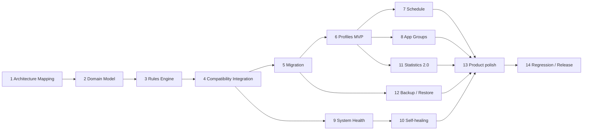

# TimeManager v0.10.0 Roadmap

日期：2026-10-22。分支：`feat/rules-engine`。基线：v0.9.0 / `cf4cad617430c412e5cc0e780f5045724cc39cb5`。依据：[Architecture Map](../architecture/2026-10-22-rules-engine-architecture-map.md)。

**本轮最终边界更新（2026-10-24）**：Owner 已接受 Phase4.3B 有界真机证据及 B/D/K 的明确缺口，并澄清 Deep Focus 不保证 Settings/recovery 详情页可访问。最终主机验证通过后，本轮止于一次本地 `refactor: unify intervention rule decisions` commit；不 push、不合并，不开始 Migration、Profile 或任何后续阶段。详见[最终验收与主机验证](../testing/2026-10-23-v0.10.0-phase4-3-accessibility-shadow.md#final-host-verification-and-local-commit-gate--2026-10-24)。下文是分阶段历史计划，不构成继续执行授权。

本路线使用 planning-and-task-breakdown 的依赖、验收和分片方法；按项目约定保存到docs/plans，任务清单合并在本文件，不恢复已退休的tasks目录。**Checkpoint A及Phase4.1已获owner / ChatGPT审查；Phase4.2 Monitor Daily/Session仲裁接线和主机验证已完成，等待本slice审查及单独授权的设备验证。不开始4.3、不操作手机、不提交或推送。**

## Goal and release scope

在已验收Daily/Session/Focus/Deep语义上建立可测试、纯领域Rules Engine，再引入Profile配置。配置和runtime账本分离；计时、04:00、Overlay宿主、HOME确认、extension和Todo/历史保持兼容。

下列14阶段构成完整候选路线，不意味着允许一次性执行。owner已确认v0.10.0第一可发布切片为Phase2–6：Domain Model、Rules Engine、Compatibility Integration、Migration、Profiles MVP。Schedule/App Groups/System Health/Self-healing/Statistics 2.0/Backup等后续阶段不要求全部纳入v0.10.0。每阶段以少量可回滚任务交付，不为追赶路线把高耦合模块同时重写。

## Dependency map

可分别规划的阶段不等于允许同时修改共享配置/服务；以已确定的合同和前置验收为准。

## Phase 1 — Architecture Mapping（本轮）

- [x] 从clean master核对本地/远端/tag基线并创建feat/rules-engine。
- [x] 阅读真实核心服务、状态、Preferences/Room、ViewModel和相关tests，形成调用链、所有权和23点决策清单。
- [x] 形成优先级/Session/Daily/capability证据、迁移草案、P0/P1/P2/P3和后续路线。

**验收**：仅这两份Markdown新增；所有图有实际symbol依据；明确历史159测试与本轮未执行的区别。

**验证**：检查源文件引用、测试静态清点、Markdown链接、git diff --check和最终文档范围。**依赖**：v0.9.0。**文件**：Architecture Map、本文件。**范围**：S（2份文档）。

## Phase 2 — Domain Model

- [x] 2.1 定义Profile/AppPolicy/DailyRule/SessionRule与独立runtime snapshot，保留缺失/显式配置含义；按owner决定，Focus活动状态独立，旧blocked set不生成preset，本阶段不增加preset实现。
- [x] 2.2 定义RuleEvaluationContext与ExecutionContextSnapshot两个边界、RuleEvaluation和execution receipt合同，显式now、usageDay、capability、generation/policyRevision。
- [x] 2.3 用v0.9.0输入样例审查边界：默认10、+8/+8/+5、+900、Deep必要例外；不接运行路径。

**验收**：纯类型与规则不依赖Android；runtime不存进Profile；不另建独立可变Episode stage。

**验证**：模型必要约束/序列JVM测试、Debug构建；确认服务和持久化路径未切换。**依赖**：P1。**拟改文件**：domain rules/profile模型和对应test，每任务2–4文件；具体命名届时确定。**范围**：M，拆成以上三个任务。

**实际结果（2026-10-22）**：新增7个domain文件、4个测试类和1份兼容fixture。新增28项focused tests；完整Debug JVM为**187项/34类，0失败、0错误、0跳过**；assembleDebug和差异检查PASS。没有改动已有Service/Repository/UI/Manifest/Gradle。模型中没有RulesEvaluator或ExecutionPlanner实现，没有第二套Episode可变状态。详见[Phase2报告](../testing/2026-10-22-v0.10.0-phase2-domain-model.md)。

## Phase 3 — Rules Engine

本轮按已批准的3.1→3.2→3.3顺序在当前会话实施，不提交、不接Android执行、不操作设备。使用writing-plans方法明确接口与验证：

1. 3.1：`RulesEvaluator.evaluate(RuleEvaluationContext): RuleEvaluation`组合只读候选；`RulePriorityResolver.priorityOf(RuleKind): Int`显式排序。新增FocusCandidateEvaluator与Focused测试。缺失事实改为RuleFactGap，缺失能力改为CandidateCapabilityGap；普通Focus补status，Concurrent快照仅表达理论上同时存在的独立规则事实，旧运行模式不变。
2. 3.2：新增DailySessionCandidateEvaluator，复用UsageLimitEvaluator.evaluateSeconds；读取previousOver/entry/retry和Friction episode/pending/admission快照，不追踪或提交状态。能力缺口针对每个候选报告，保留缺增强能力时的软提醒事实。运行对应focused tests。
3. 3.3：增加全组合矩阵、现有纯helper同输入parity与确定性测试；运行focused tests，再完整testDebugUnitTest与assembleDebug。静态检查新engine无Android/存储/时钟/可变runtime依赖，更新Phase3报告后停止，等待Checkpoint A审查。

核心断言示例：`assertEquals(RuleKind.DAILY, evaluator.evaluate(dailyAndSession).selected?.kind)`；重复评价后`assertEquals(beforeSession, context.session)`。各切片通过后才勾选下列清单。Phase2历史报告保留原样。

- [x] 3.1 以现有纯Daily和Focus/Deep policy为基准，统一候选评价/原因/显式优先级；Deep必要系统例外只豁免Deep规则。
- [x] 3.2 读取Friction不可变快照评价Session due，明确“evaluate不提交stage，成功receipt才提交”；缺失事实及能力按规则/候选表达。
- [x] 3.3 完成纯JVM matrix和99项旧helper同输入parity；完整351项/41类通过，Debug构建通过。

**验收**：确定性、无Context/Service/Compose/WindowManager；Daily>Session等P0等价；评价函数无持久化和计时副作用。

**验证**：focused rules tests、完整Debug JVM回归、assembleDebug；无需真机验证纯函数。**依赖**：P2。**文件**：RulesEvaluator/PolicyResolver、复用policy适配、测试；单任务≤5文件。**范围**：三项M。

**Phase3主体完成时的历史结果（2026-10-22）**：新增5个纯规则文件、7个测试类；相对Phase2新增164项测试（含对应合同测试补充）。351项/41类，0失败、0错误、0跳过；assembleDebug与包含未跟踪文件的差异检查PASS。无Service/UI/持久化/Manifest/Gradle改动；PolicyResolver不需要，输入已经是EffectiveAppPolicy。详见[Phase3报告及后续加固](../testing/2026-10-22-v0.10.0-phase3-rules-engine.md)。原先需在接线时额外保留的Daily持续压制缺口，已由下述Checkpoint A加固移入domain合同；HOME确认和窗口所有权仍属于执行门控。

### Checkpoint A — Domain parity

模型、优先级和Episode成功提交合同审查通过；已有159项的实际后续结果另行记录，不拿旧数字代替新验证。确认未改变默认或用户真实额度，再进入Service接线。

**Contract hardening执行计划（不是Phase4）**：使用writing-plans方法在现有路线图内记录，本轮不commit、不操作设备。

1. 先在CheckpointAHardeningTest复现两个现有缺口：普通Focus缺application-overlay却出现能力缺口；稳定超额无展示边沿时Session被错误选中。
2. 只调整domain/rules：`CandidateCapabilityEvaluator.missing`排除普通Focus的application-overlay要求；为`RuleEvaluation`/内部候选事实增加冻结的`activeConstraints`，由Daily当前reached状态提供DAILY，与展示候选分开。`RulePriorityResolver.select/suppressed`按活动约束仲裁；Session被Daily持续压制时记录DAILY_ACTIVE，不凭空创建Daily展示候选。
3. 新增延长解除、跨usage-day、重复评价、缺边沿、Focus/Deep能力差异及旧监控guard对照测试；更新受影响的合同测试。断言例：`assertNull(stableOver.selected)`且`assertTrue(RuleKind.DAILY in stableOver.activeConstraints)`。
4. 跑focused tests、完整testDebugUnitTest与assembleDebug、包含未跟踪文件的差异检查；在Phase3报告追加hardening结果，保留原351项历史。通过后只记录Checkpoint A已加固，不勾选Phase4。

- [x] Domain parity hardened：普通Focus不依赖application-overlay；Daily active与display eligibility分离，DAILY_ACTIVE持续压制由纯domain负责。
- [x] 主机验证：新增27项，完整378项/43类，0失败/错误/跳过；assembleDebug和差异检查PASS。
- [x] Owner / ChatGPT对合同加固的复核：本次Phase4.1指令明确确认Checkpoint A通过。

**合同层READY_FOR_PHASE_4: YES**；缺口已闭合，已按本次授权仅进行下述4.1 shadow slice，未授权切换真实执行。

## Phase 4 — Compatibility Integration

### Phase4.1 execution plan — shadow only

Owner已通过Checkpoint A。本slice使用writing-plans分片方法在当前会话实施，不运行设备流程，不commit；4.2/4.3未授权。

1. 在原LimitInterventionManager/TriggerState增加只读preview，返回现有previous/entry/retry和窗口可用事实，不调用evaluate、不消费entry。Coordinator仅增加同步只读foreground observation，复用已有generation；无观测时明确标记Monitor observation identity，不另建generation。
2. 新增monitor/shadow/LegacyRulesSnapshotAdapter，输入已有config/usage/effective limit/episode/health快照，输出限定Daily/Session范围的RuleEvaluationContext。显式配置与未配置保持区分，Focus/Deep不伪造为本slice已验证。缺config/usage/edge返回可测试的insufficient事实。
3. 新增ShadowRuleComparison和MonitorRulesShadow；capture在旧干预前只读评价，complete在旧selector之后对照实际decision。Daily active/display与Session due分别比较；窗口/权限/Coordinator gate只影响execution comparison，不冒充业务mismatch。只持有shadow revision/sequence和诊断去重，不持有第二份业务账本。
4. UsageMonitorService仅增加Debug capture/complete、3类config Flow emission的shadow revision和低噪声诊断；旧Daily evaluate/select/HOME/Overlay调用顺序不变。Shadow异常必须在shadow层内部隔离，不能进入旧monitor异常清理。
5. 先验证adapter/preview/comparison/identity/exception隔离，再完整testDebugUnitTest、assembleDebug及定向diff审计。报告真实mismatch、已知表示差异和未验证设备路径；仅完成后勾4.1，随后停止。

核心验收：stable over-limit context的`activeConstraints`包含DAILY，selected为空，Session以DAILY_ACTIVE压制；旧decision None与旧selector的Daily优先标记应比较为business MATCH，而不是要求重复展示。配置revision变化不改episode或ledger；Release不执行shadow。

- [x] 4.1 添加legacy config/runtime snapshot adapter，在Monitor中先对照评价结果，不驱动第二套执行。

### Phase4.2 execution plan — Monitor arbitration only

Owner已确认Phase4.1 parity审查。本slice使用writing-plans，在当前会话顺序执行，不提交、不操作设备，不开始4.3。

- [x] 将Phase4.1 capture原样抽为`monitor/rules/MonitorRulesEvaluation`：三个config readiness/revision在所有构建中生效；Debug facade共享同一个capture实例和结果，不重复评价。
- [x] 新增`MonitorRulesCompatibilityProjection.project(RuleEvaluation, MonitorExecutionAvailability)`和`MonitorRulesArbitrator.decide`：前者只映射Daily持续压制/Session许可，后者集中处理不足事实、异常、stale和不可能合同的单轮legacy fallback。正常mismatch仅Debug记录，不改用旧结果。
- [x] 在Service旧selector位置接`arbitration.allowsSession`，仍调用原`showSessionGate`；Daily evaluate/handle顺序和次数不变。capture与decision/config更新均在原timingMutex内；不因本轮Daily执行自身改变窗口/foreground而错误重算旧edge。
- [x] 新增projection和application-boundary tests，覆盖stable/actionable Daily、extension释放、startup/缺usage、异常/stale、窗口/能力、Release无诊断路径、无二次edge/stage/extension写入。保留原411项期望。
- [x] 完整testDebugUnitTest、assembleDebug、包含未跟踪文件的差异检查；更新Phase4.2报告，仅主机结果通过后勾选4.2。Release业务路径用非Debug依赖测试+静态调用链确认，不触碰签名流程。

关键断言：稳定超额返回`SUPPRESS_SESSION_DAILY`但无新增Daily show；无诊断时`legacySelection`不调用；fallback时旧selector仅一次，edge仍一次。新增生产文件只限monitor/rules，既有shadow facade只委托采集，Service只局部接线。

- [x] 4.2 只切Daily/Session决策入口，保留AppTimer/U、F唯一state、HOME confirmation、Overlay host和通知执行。（主机完成；2026-10-23 owner人工核心验收通过）
- [ ] 4.3 将Accessibility的Focus/Deep/re-entry调用接同一合同，保留stable window/generation与一次token；验证fallback/重连。
  - [x] 4.3A：只读Accessibility snapshot / priority projection / shadow对照与主机验证；不驱动执行。新增50项，Debug 528/60、Release 502/57，均0失败/错误/跳过；构建/编译通过。
  - [ ] 4.3B：owner / ChatGPT审查shadow后单独授权切换；当前pending。

**4.1实际结果（2026-10-22）**：新增3个shadow生产文件、4个测试类与1份fixture；新增33项，完整411项/47类，0失败/错误/跳过；assembleDebug和差异检查PASS。13个正常parity场景全部MATCH，意外mismatch为0（仅主机测试，未采集真机shadow数据）。Monitor仅40新增/4删除行；Limit/Coordinator仅新增只读访问器；Accessibility/Friction/Checkpoint A规则合同未改。详见[Phase4.1报告](../testing/2026-10-22-v0.10.0-phase4-1-shadow-monitor.md)。READY_FOR_PHASE4_2: YES（主机技术就绪，等待owner / ChatGPT审查和后续实施指令）；4.2/4.3未开始。

**4.2实际结果（2026-10-22）**：新增2个monitor/rules生产文件、2个测试类；修改既有shadow facade以复用同一次评价，Service局部切换。新增37项，完整**448项/49类，0失败/错误/跳过**；assembleDebug及差异检查PASS。Daily持续压制、既有Daily展示一次、extension释放、单轮fallback、Release共用入口及Debug reverse parity通过。未改Daily/Friction transition、HOME、Overlay、Accessibility或规则合同。详见[Phase4.2报告](../testing/2026-10-22-v0.10.0-phase4-2-monitor-arbitration.md)。READY_FOR_PHASE4_2_DEVICE_VALIDATION: YES；READY_FOR_PHASE4_3: NO。这里的完成仅代表主机接线和验证，不代表设备/owner验收。

**验收**：两个服务不各自保留可独立变化的新规则；执行receipt幂等；失败继续Fail Open，普通软页不因Accessibility丢失消失。

**验证**：旧/新事件序列对照、JVM、Debug构建；届时按DEVICE_SAFETY使用Dev进行必要HOME/Gate/Daily/Focus回归并独立owner验收。本轮没有设备授权延伸到这些未来步骤。**依赖**：P3/Checkpoint A。**文件**：adapters、Monitor、Accessibility、Coordinator及测试，按三个切片分别修改。**范围**：多个M，不能一次重写两个Service。

## Phase 5 — Migration

- [ ] 5.1 决定Profile配置存储（独立DataStore或显式Room升级），制定schemaVersion/确定性Default ID/marker。
- [ ] 5.2 迁入tracked+base+原始session配置；显式15与缺失继承10分开；活动Focus仍保持runtime。
- [ ] 5.3 验证重入幂等、部分失败重试、读取失败不固化empty、用户后续修改不被重迁；保留旧数据兼容路径。

**验收**：不重复Default；same-day extension/usage/receipts不动；不破坏Todo与usage_history；不新增破坏式数据库回退。

**验证**：真实存储migration测试（独立测试环境）、旧数据fixture与重复迁移断言、JVM/构建。**依赖**：P4；需配置存储设计决定。**文件**：Profile storage/repository、migration、fixtures/tests；如果选Room再显式改AppDatabase版本，不提前承诺改schema。**范围**：三项M。

## Phase 6 — Profiles MVP

- [ ] 6.1 Default Profile及手动选中一个Profile；配置可查看/编辑且有稳定ID。
- [ ] 6.2 把现有Daily/首轮Session编辑复用到AppPolicy，不复制一套额度保存逻辑。
- [ ] 6.3 切换Profile产生明确policyRevision，计时/当日extension/Session是否接续遵循owner确认的兼容语义。

**验收**：配置改变实时传播至Home/Detail/Monitor；切换不意外清账/重arm；没有虚假有效开关。

**验证**：Repository/Flow单测、界面与Dev必要回归、owner验收。**依赖**：P5；owner先定切换语义。**文件**：ProfileVM/Screen、现有设置/详情小范围接线及测试，各任务≤5文件。**范围**：三项M。

### Checkpoint B — First releasable slice

Rules兼容、Default迁移和手动Profile验收完成后，owner决定是否以这一切片进入发布回归，或继续后面阶段。不能因为路线包含更多功能就把已验收切片长期悬空。

## Phase 7 — Schedule

- [ ] 7.1 定义时间窗/星期/时区与重叠profile选择策略；独立于04:00 usageDay。
- [ ] 7.2 纯ScheduleResolver接EffectivePolicy；再实现必要的触发与配置UI。

**验收**：重叠可解释；无匹配按明确Default策略；切换不会重置当日账本或Episode。

**验证**：固定clock/时间窗边界JVM测试、配置Flow、Dev必要运行回归。**依赖**：P6和owner重叠策略决定。**文件**：schedule model/resolver/tests，后续独立adapter/UI任务。**范围**：M+M；不与迁移同做。

## Phase 8 — App Groups

- [ ] 8.1 定义组成员、组默认与单App override优先级，只影响配置解析。
- [ ] 8.2 复用App Picker和policy编辑，提供可解释的最终规则来源。

**验收**：同包多组冲突有明确结果；不会按组重复累加usage/extension；保持package级计时。

**验证**：PolicyResolver组合测试、UI/选择状态测试。**依赖**：P6；可与Schedule分别规划，共享resolver修改仍串行。**文件**：group model/repository/resolver和独立UI切片。**范围**：两项M。

## Phase 9 — System Health

- [ ] 9.1 在现有PermissionHealthManager上补充规则执行所需能力/连接事实与诊断原因。
- [ ] 9.2 UI展示已知能力及功能降级，不宣称enabled=connected或已保护。

**验收**：复用现有三态；与Engine输入一致；缺Usage/Overlay/通知/Accessibility分别描述实际影响。

**验证**：状态映射/连接变更JVM，Dev权限生命周期回归。**依赖**：P4稳定接线。**文件**：PermissionHealth投影/adapter及UI，分开提交范围。**范围**：两项M。

## Phase 10 — Self-healing

- [ ] 10.1 界定可恢复的内部状态与明确不可自动恢复的OS权限/厂商绑定状态。
- [ ] 10.2 实现有限、幂等的内部恢复与用户可见引导，沿用Fail Open。

**验收**：不循环HOME、不无限重启服务、不假装重新获得权限；恢复不丢配置/usage/extension。

**验证**：断线/命令超时/进程恢复序列与Dev适量回归。**依赖**：P9；先明确实际观测缺口。**文件**：recovery policy/adapter/test；不默认重写计时。**范围**：M+M。

### Checkpoint C — Effective policy and capabilities

Schedule/Groups如纳入本次发布，须有确定的配置解析优先级；Health和恢复必须使用同一个capability合同。确认不存在三套“当前生效Profile”或两套Episode state，再继续统计/备份整合。

## Phase 11 — Statistics 2.0

- [ ] 11.1 明确当前Profile集合与历史归因范围，评估旧记录无profileId的事实。
- [ ] 11.2 在保留04:00和high-water快照规则的前提下扩展查询/展示；未知历史维度不伪造。

**验收**：不重复计时；旧usage_history/Todo保持；无法按历史Profile归因时诚实采用全局/当前集合说明。

**验证**：聚合/范围JVM、如需schema则migration tests、UI检查。**依赖**：P6和统计scope决定；可推迟。**文件**：statistics model/calculator/VM，再单独UI任务；schema变化另审。**范围**：两项M。

## Phase 12 — Backup / Restore

- [ ] 12.1 定义导出配置版本、Profile/AppPolicy引用和runtime数据取舍，不导出秘密或当前overlay/token。
- [ ] 12.2 验证恢复先校验后提交、重复导入策略；不把过期Focus session或昨日extension当新配置激活。

**验收**：损坏输入不覆盖有效配置；Todo/history是否包含有显式产品范围；04:00账本identity保持一致。

**验证**：往返/版本/幂等导入纯测试与真实存储测试。**依赖**：P5确定schema，P6模型稳定。**文件**：backup format/validator/repository与单独UI切片。**范围**：两至三项M。

## Phase 13 — Product polish

- [ ] 13.1 统一Profile、effective policy来源和能力提示的显示文案；复用现有Material3组件。
- [ ] 13.2 回归导航、空状态、Dark/Light、字体和Overlay横屏；仅处理纳入范围的真实问题。

**验收**：无无效开关/混淆Daily与Session动作；用户能辨认当前配置来源；不借美化改变已验收行为。

**验证**：界面检查、相关显示helper测试和owner体验。**依赖**：本次选择纳入的P6–12切片完成。**文件**：对应Compose页面/共用组件/文案，每次≤5文件。**范围**：若干S/M。

## Phase 14 — Regression / Release

- [ ] 14.1 收拢本轮真实修改范围，执行新的JVM/构建和兼容矩阵，更新可公开测试报告。
- [ ] 14.2 Dev必要真机回归及owner独立验收；重看P0、权限/背景/来电已知缺口，不把旧smoke扩写为全覆盖。
- [ ] 14.3 经用户另行授权进行release freeze、签名与metadata、commit后重建；push/tag/publication各自授权。

**验收**：无测试覆盖残留或用户配置污染；签名秘密和APK不入Git；owner确认发布范围和已知限制。

**验证**：实际运行结果与未验证项分开报告，clean frozen commit生成发布APK。**依赖**：纳入发布的阶段全部验收。**文件**：testing/release文档、届时版本配置（本轮不改）。**范围**：按host验证、Dev验收、发布准备拆分。

## P0 invariants and risk checkpoints

| 约束 | 必须在哪阶段证明 |
| --- | --- |
| DEEP > FOCUS > DAILY > SESSION，Deep必要系统例外 | P3纯规则 + P4两入口 |
| Session HOME等待真实launcher；重复事件不形成新entry/HOME循环 | P4 + P14 Dev/owner |
| F唯一Episode状态，首轮保存值、+8/+8/+5、lastEngagement真休息 | P2/P3合同 + P4动作receipt |
| 单stage gate一次；Continue不改Daily；延长不改Episode | P3/P4 |
| base+当日extension，每次+900不限次数；04:00不清base或Session | P3/P4/P5 |
| 缺增强能力仍软提醒；Focus/Deep不假称保护；COMPLETED立即停阻止 | P3/P4/P9 |
| 迁移幂等、不清Todo/history/当天extension、不覆盖显式配置 | P5真实存储验证 |

P1耦合与具体风险见Architecture Map R1–R7；优先控制配置revision、异步执行receipt与usage来源，不借本路线顺手修历史统计。P2等待模型/遗留接口和P3文案布局分批处理，不都归为发布阻塞。

## Owner decisions confirmed for Phase 2

1. 同package、同usageDay跨Profile共享usage、extension和Daily通知receipt；切换仅改变配置，不重置Episode/stage或重新arm已消费gate。
2. Profiles MVP有稳定Default、最多一个手动active Profile；不存在或不可用时回退Default。自动Schedule属于Phase7，本阶段只表达配置来源，不实现选择算法。
3. active Focus/Deep的start/end/status/blocked set保持runtime，旧blocked set不自动生成preset；未来仅允许用户显式保存preset。
4. v0.10.0第一可发布切片是Phase2–6；后续阶段单独规划。
5. Statistics保持全局managed-app历史口径；不为没有profileId的旧Room记录伪造Profile归因。

**当前Phase1–3、Checkpoint A、Phase4.1及Phase4.2主机接线完成。** 新Engine仅对Monitor普通tick的Daily-vs-Session仲裁负责；Daily/Session执行仍是原路径。READY_FOR_PHASE4_2_DEVICE_VALIDATION: YES（待审查和设备单独授权）；READY_FOR_PHASE4_3: NO。Architecture Map和Phase2/3/4.1历史报告保留，不静默回写。

**2026-10-23 后续 owner 验收更新**：同App 60s Daily、每15s Session、+30s extension 的人工流程已确认 Daily优先、被压制Session不commit、Episode保留及后续re-entry/递进连续。`PHASE4_2_CORE_ENGINE_DEVICE_GATE=PASS`、`READY_FOR_PHASE4_3=YES`；详见[owner追加记录](../testing/2026-10-22-v0.10.0-phase4-2-device-validation.md#owner-manual-acceptance--2026-10-23)。仅授权当前[4.3A计划](2026-10-23-phase4-3a-accessibility-shadow.md)，没有授权自动切换4.3B或继续真机操作。

**4.3A后续主机结果**：只读shadow完成；Legacy Accessibility执行仍authority。有效事实矩阵意外业务mismatch为0；新Service差异仅25新增/2删除行，既有执行不重写。Deep旧分支提前返回、能力门控和Daily执行后generation变化均在[4.3A报告](../testing/2026-10-23-v0.10.0-phase4-3-accessibility-shadow.md)单列，不能静默当作全局Allow或重新执行命令。`READY_FOR_PHASE4_3B_AUTHORITATIVE_SWITCH=NO`（待owner/ChatGPT审查及单独切换授权）；没有真机操作。
